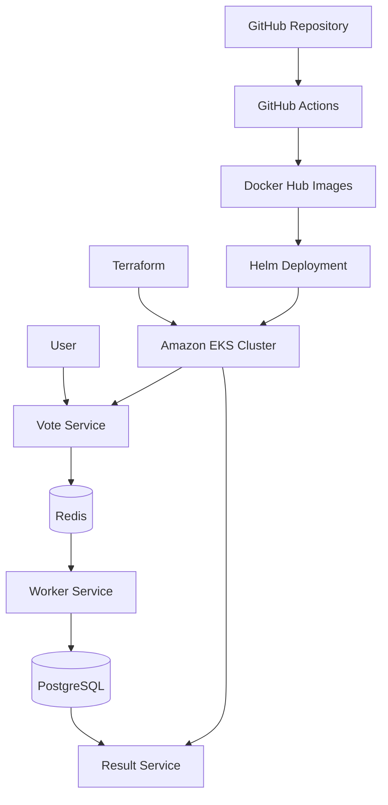

# Voting App — DevOps Capstone

## Project Overview

This project deploys the Example Voting App to Amazon EKS using Kubernetes and Helm. Terraform manages the EKS infrastructure, and Docker Hub hosts the application container images.

## Architecture

## Technology Stack

- AWS Amazon EKS
- Terraform
- Kubernetes
- Helm
- Docker and Docker Hub
- GitHub Actions
- Trivy vulnerability scanning
- Redis and PostgreSQL

## Infrastructure

- AWS region: `eu-west-1`
- EKS cluster: `voting-app-cluster`
- Kubernetes namespace: `voting-app`
- Helm release: `voting-app`
- Kubernetes version configured in Terraform: `1.36`
- Worker node instance type: `t3.small`

Terraform checks completed:

- `terraform fmt -check`: passed
- `terraform validate`: passed

## Application Deployment

The Helm chart is located at `helm/voting-app`.

The deployed application images are:

- `bigmo44/examplevotingapp_vote:latest`
- `bigmo44/examplevotingapp_result:latest`
- `bigmo44/examplevotingapp_worker:latest`

Supporting images:

- `redis:alpine`
- `postgres:15-alpine`

The current Helm release is revision 4 and has status `deployed`.

## Verification

The following checks succeeded:

- Helm chart lint completed with zero chart failures.
- All five application deployments were ready.
- All five application pods were running.
- Vote and Result services were exposed through Kubernetes NodePort services.
- A test vote submitted through the Vote page appeared on the Result page.
- Helm release history was inspected.

## Security Scanning

Trivy scan of the Vote image reported:

| Component | Total findings | Low | Medium | High | Critical |
|---|---:|---:|---:|---:|---:|
| Operating-system packages | 284 | 145 | 89 | 49 | 0 |
| Python packages | 7 | 1 | 2 | 4 | 0 |

These findings require remediation. Zero Critical findings does not mean the image is vulnerability-free. Review the Trivy reports and update affected base-image and Python dependencies, then rebuild and rescan the image.

The scan reports are retained in the application repository, along with a CycloneDX SBOM.

## Evidence

The `evidence/` directory contains captured deployment evidence, including:

- Voting page screenshot
- Results page screenshot
- Helm status
- EKS nodes
- Kubernetes services and pods
- Helm release history

## Limitations and Follow-up Work

- The deployed application images currently use the `latest` tag. Immutable image tags should be published and verified for reproducible deployments.
- Trivy findings remain to be remediated and rescanned.
- Terraform was formatted and validated; these checks do not by themselves prove that every infrastructure setting is optimal.
- External access and production-grade security hardening should be reviewed before production use.

## Cleanup

AWS resources are intentionally left running. Review the evidence and estimated ongoing AWS charges before deciding whether to stop or remove any resources.
